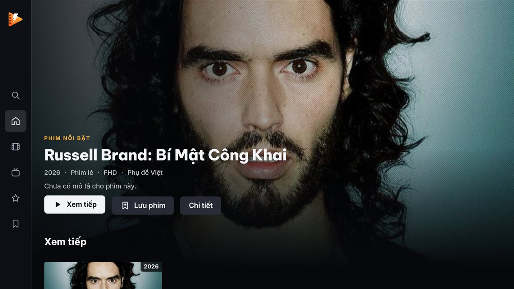
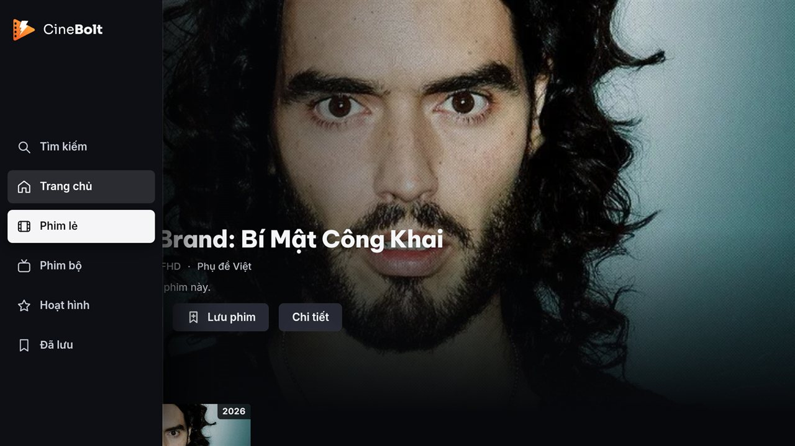
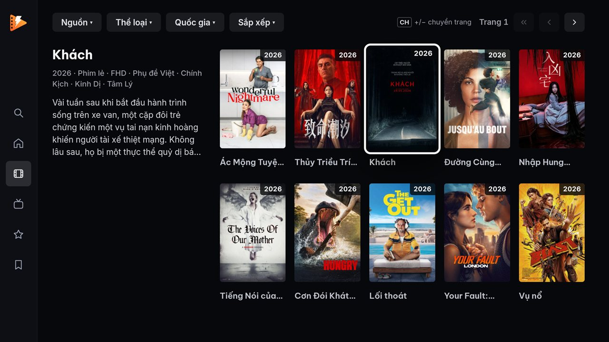
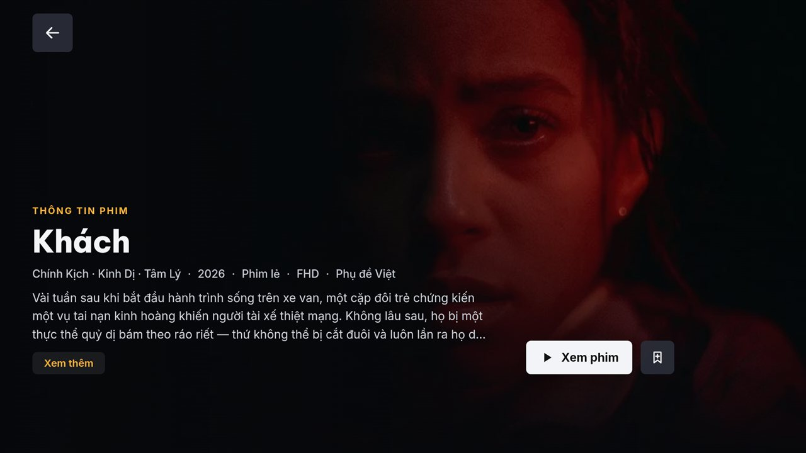
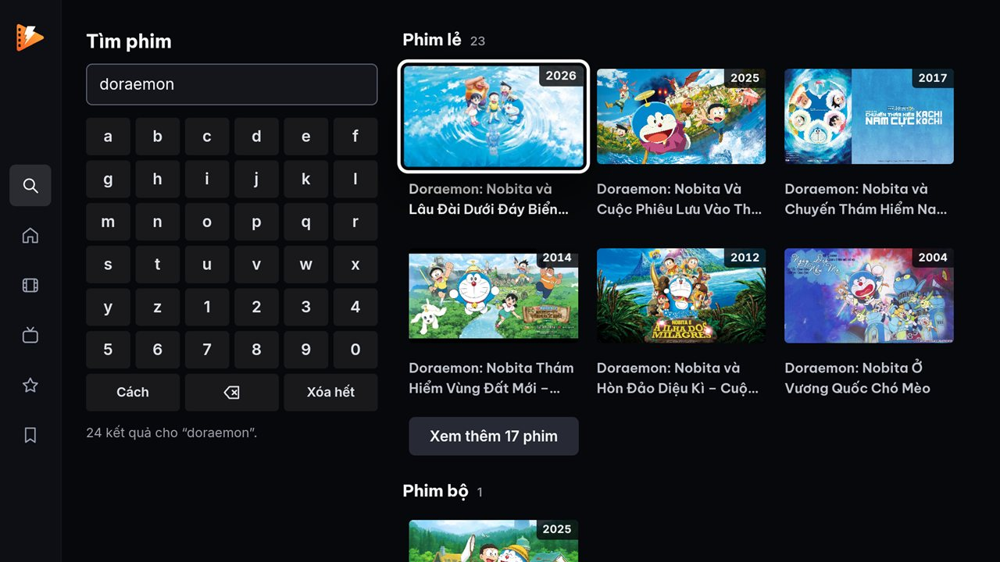
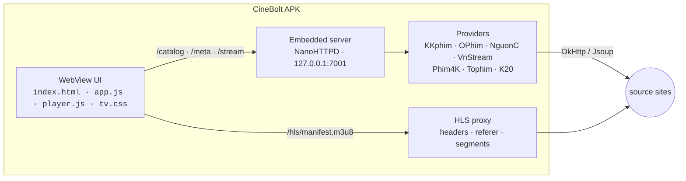

<div align="center">


# CineBolt

**A fast, remote-first movie & series app for Android TV — with its own backend built in.**

Vietnamese catalogs from seven sources, one clean 10-foot interface, zero servers to run.


**[⬇ Download the latest APK](https://github.com/latiosthinh/cinebolt/releases/latest)**



</div>

---

## Why CineBolt

Most streaming clients for TV either need a separate server on your network or are a phone UI stretched onto a big screen.
CineBolt is neither:

- **Self-contained.** The catalog/stream backend runs *inside the app* as a tiny Kotlin HTTP server on `127.0.0.1:7001`. Install the APK and it works — no PC, no Docker, no config.
- **Built for the remote.** Every screen is designed for a D-pad: predictable focus, spatial navigation, a collapsible sidebar, and hardware keys (CH+/CH−, ⏩ ⏪, ⏯) that do what you expect.
- **Light on old TV hardware.** A single WebView with hand-written HTML/CSS/JS — no framework, no blur effects, cached catalog responses, lazy work only when focus settles.

## Screenshots

<table>
  <tr>
    <td width="50%"><br><sub><b>Sidebar</b> — an icon column that widens to show every label when focused.</sub></td>
    <td width="50%"><br><sub><b>Browse</b> — filters on top, 2×5 poster grid, and an info column with the full title of the focused film.</sub></td>
  </tr>
  <tr>
    <td><br><sub><b>Details</b> — synopsis with “Xem thêm”, resume/play, save, and an episode list for series.</sub></td>
    <td><br><sub><b>Search</b> — on-screen keyboard, no diacritics needed, results from every source.</sub></td>
  </tr>
  <tr>
    <td colspan="2"><br><sub><b>Player</b> — custom TV controls over HLS playback, with resume where you left off.</sub></td>
  </tr>
</table>

## Features

| | |
|---|---|
| 🏠 **Home** | Featured hero, a **Xem tiếp** (continue watching) row with progress bars, and fresh rows per catalog. |
| 🎞️ **Phim lẻ · Phim bộ · Hoạt hình** | Filter by source, genre and country; sort by year, latest update or name (A→Z / Z→A); 10 posters per page with first/prev/next paging. |
| 🔎 **Search** | Queries movies and series across all sources at once; stale results never overwrite a newer screen. |
| 📺 **Series** | Episode tabs, remembers the last episode per show and offers the next one when an episode is finished. |
| ▶️ **Player** | HLS via `hls.js`, ±10 s, ±1 min and ±5 min seeking, hold to seek faster, mute, hide controls, and a retry button on errors. |
| 💾 **Đã lưu** | Save films for later, kept on the device. |
| ⏱️ **Resume** | Playback position is stored per film/episode; Play picks up where you stopped. |

## Remote controls

| Key | Where | Action |
|---|---|---|
| ◀ ▶ ▲ ▼ | everywhere | Move focus (spatial navigation) |
| ◀ from the left edge | any page | Open the sidebar on the current tab |
| OK | card / button | Open details · press · play |
| Back | details / player / popups | Close and return focus where you were |
| **CH+ / CH−** | category pages | Next / previous page |
| ⏩ / ⏪ | category pages | Next / previous page |
| ⏩ / ⏪ | player | Seek ±10 s |
| ◀ / ▶ | player | Seek (hold to go faster) |
| ▼ | player, bottom row | Hide the controls |
| ⏯ | player | Play / pause |

## How it works



The UI talks to the embedded server using a small add-on style JSON API:

| Endpoint | Returns |
|---|---|
| `GET /manifest.json` | Available catalogs and sources |
| `GET /catalog/{type}/{id}.json` | A page of films (supports genre, country, year sort, paging) |
| `GET /meta/{type}/{id}.json` | Full details and episode list |
| `GET /stream/{type}/{id}.json` | Playable streams for a film or episode |
| `GET /hls/manifest.m3u8?url=…` | Proxied HLS playlist/segments with the headers the source needs |

IDs are prefixed by source (`kk_`, `op_`, `nc_`, `vn_`, `p4k_`, `tp_`, `k20_`), and IMDb `tt…` ids are resolved through Cinemeta.

## Project layout

```
CineBolt/
├── UI/                         ← the app's interface (edit here)
│   ├── index.html              design tokens, markup
│   ├── app.js                  navigation, catalogs, details, search, history
│   ├── player.js               player and its remote controls
│   └── tv.css                  10-foot layout and focus styles
├── android-tv/                 Gradle project
│   └── app/src/main/
│       ├── java/com/cinebolt/tv/
│       │   ├── MainActivity.kt         WebView host, key bridge (Back, media, CH±)
│       │   └── backend/                embedded server, router, HLS proxy, providers/
│       └── assets/                     copy of UI/ (generated by sync-ui)
├── scripts/
│   ├── sync-ui.cjs             copy UI/ into the APK assets
│   ├── test-ui.cjs             dependency-free UI regression tests
│   └── make-logo.cjs, make-banner.ps1   brand assets
└── docs/screenshots/
```

## Build & install

**Requirements:** JDK 17, Android SDK (platform 34), Node.js 18+ for the scripts, and `adb`.

```bash
# 1. copy the UI into the app and run the UI tests
node scripts/sync-ui.cjs
node scripts/test-ui.cjs

# 2. build the debug APK (Windows)
cd android-tv
gradlew.bat assembleDebug

# 3. install on a TV or emulator
adb connect <tv-ip>:5555          # once, with ADB debugging enabled on the TV
adb install -r app/build/outputs/apk/debug/app-debug.apk
```

Backend unit tests: `gradlew.bat test`.

### Development loop

1. Edit files in `UI/` — never in `android-tv/app/src/main/assets/` (they are overwritten).
2. `node scripts/sync-ui.cjs && node scripts/test-ui.cjs` — the tests also fail if the assets drift from `UI/`.
3. Rebuild and reinstall. To inspect the live UI, forward the WebView's DevTools socket:
   ```bash
   adb forward tcp:9333 localabstract:webview_devtools_remote_$(adb shell pidof com.cinebolt.tv)
   ```
   then open `chrome://inspect` (or talk to `localhost:9333` over the DevTools protocol).

## Design notes

- **Focus is the hero.** The focused control is a solid light fill; posters get a ring and a small lift. Selection uses white glass, and the amber accent is reserved for “changed” and “continue” cues.
- **One spacing step.** Layout uses 4/8 px steps; radii are 4 (art, chips), 6 (controls) and 8 (floating panels).
- **Everything fits.** Pages are designed against 960×540 CSS px (1080p at 2×) so two poster rows, captions and focus rings fit without scrolling.

## Disclaimer

CineBolt does not host, upload or store any media. It is a client that reads publicly available catalog pages and plays streams provided by third-party websites. Availability and legality of that content depend on those sites and on your jurisdiction — use it responsibly.
